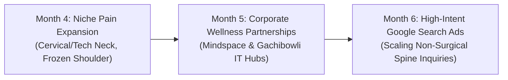

# Month 3 SEO, CRO & Local Authority Strategy Report
**Clinic:** Thrive Pain Clinic, Wellness & More  
**Location:** 4th Floor, Bharathi Square, Nandi Hills, Raidurgam, Hyderabad – 500081  
**Phase:** Month 3: Momentum (Objective: Strengthen + Expand)  
**Target Region:** Raidurgam, HITEC City, Gachibowli, Madhapur, Financial District, Hyderabad  

---

## 1. Executive Summary

Month 3 marks the transition from foundational technical setup and initial indexation into **aggressive topical authority and conversion acceleration**. 

Building upon the infrastructure completed in Months 1 and 2:
* **Month 1 (Foundation):** Technical hygiene, Core Web Vitals optimization, Google Search Console & GA4 instrumentation, and Google Business Profile (GBP) verification.
* **Month 2 (Pillar Publication & Local Citations):** Deployment of primary pillar guides (`/back-pain-treatment-in-hyderabad` and `/knee-pain-treatment-in-hyderabad`) paired with hyper-local schema and core citations.
* **Month 3 (Momentum - Strengthen + Expand):** Launching the dedicated **Sciatica Treatment in Hyderabad** local pillar, refreshing core back pain educational assets, publishing advanced procedural recovery guides, initiating corporate wellness partnerships in Cyberabad, and optimizing landing page conversion rates ahead of scaled paid traffic.

---

## 2. Weekly Content Execution Status (Content Calendar)

| Schedule | Asset / Topic | Target Primary Keyword | Target URL / Slug | Status |
| :--- | :--- | :--- | :--- | :--- |
| **Month 3 - Week 1** | **Sciatica Treatment in Hyderabad** (Local-Intent Pillar Page) | `sciatica treatment in hyderabad` | `/sciatica-treatment-in-hyderabad` | **COMPLETED** |
| **Month 3 - Week 2** | **Understanding Persistent Back Pain** (Content Refresh & Pillar Linking) | `persistent back pain causes` | `/blog/understanding-persistent-back-pain` | **COMPLETED** |
| **Month 3 - Week 3** | **Recovery Timeline After a PRP or RFA Procedure** (SEO Article 5) | `prp rfa recovery timeline` | `/blog/recovery-timeline-after-prp-or-rfa-procedure` | **COMPLETED** |
| **Month 3 - Week 4** | **When to See a Pain Specialist vs. General Physiotherapist** (SEO Article 6) | `pain specialist vs physiotherapist` | `/blog/when-to-see-a-pain-specialist-vs-physiotherapist` | **COMPLETED** |

---

## 3. Core SEO & Keyword Cluster Expansion

### A. Primary Keyword Performance & Mapping (Hyderabad Corridor)

| Keyword Cluster | Primary Target Page | Search Intent | Target Geographies |
| :--- | :--- | :--- | :--- |
| **"sciatica treatment in hyderabad"** | `/sciatica-treatment-in-hyderabad` | Commercial / Local | Raidurgam, Gachibowli, HITEC City |
| **"back pain treatment in hyderabad"** | `/back-pain-treatment-in-hyderabad` | Commercial / Local | Kondapur, Madhapur, Jubilee Hills |
| **"knee pain treatment in hyderabad"** | `/knee-pain-treatment-in-hyderabad` | Commercial / Local | Cyberabad, Financial District |
| **"prp therapy for knee in hyderabad"** | `/blog/prp-therapy-for-knee-osteoarthritis` | High Commercial Intent | Hyderabad Metropolitan Area |
| **"radiofrequency ablation for back pain"** | `/services/interventional-procedures` | Clinical / Investigative | South India, Telangana |
| **"pain specialist near me raidurgam"** | `/doctors` | Direct Navigational | Raidurgam, Nandi Hills, Shaikpet |

### B. Identified Content Gaps for Next Content Sprint (Month 4)
Based on Google Search Console queries and competitor gap analysis in Cyberabad:
1. **"Cervical Radiculopathy & Tech Neck"**: Extreme volume from IT software workforce in HITEC City / Mindspace experiencing radiating neck and shoulder numbness from prolonged workstation slouching.
2. **"Plantar Fasciitis Non-Surgical Treatment"**: High local demand for ultrasound-guided dry needling and PRP for chronic heel pain among runners and professionals.
3. **"Frozen Shoulder Hydrodilatation"**: High-conversion search term for diabetics experiencing severe glenohumeral stiffness without surgery.

---

## 4. Local Authority & Partnerships Blueprint (Raidurgam / HITEC City)

### A. Corporate Ergonomics & Wellness Partnerships
Thrive's location in Bharathi Square, Raidurgam places it directly adjacent to major IT and financial hubs (Mindspace, Knowledge City, DivyaSree Orion, Waverock).

* **Target Programs:**
  * "Ergonomics & Desk-Bound Spine Health" corporate brown-bag webinars.
  * Rapid triage consultations for corporate employees experiencing acute disc flare-ups or sciatica.
* **Corporate Targets:** IT firms, multinational technology centers, and consulting agencies with 500+ desk-bound staff in Cyberabad.

### B. Sports Club & Athletic Outreach
* **Target Organizations:** Local badminton academies, marathon running clubs, and CrossFit gyms in Gachibowli and Jubilee Hills.
* **Value Hook:** Clinical workshops on "Patellar Tendinopathy vs. Meniscal Tears" and "Dynamic Musculoskeletal Ultrasound Screenings".

### C. Local Directory & Citation Standardization
Ensure exact NAP (Name, Address, Phone) consistency across:
* **Google Business Profile (GBP):** Verified address: *4th Floor, Bharathi Square, Plot No. 58, Sy No. 5/3, Nandi Hills, Raidurgam, Cyberabad, Hyderabad 500081*.
* **Practo & Lybrate:** Claimed clinic profile under *Interventional Pain Medicine & Physical Rehabilitation*.
* **Justdial & Sulekha Hyderabad:** Primary categories: *Pain Management Doctors, Physiotherapy Clinics in Raidurgam*.

---

## 5. Conversion Rate Optimization (CRO) Enhancements

### Key Adjustments Implemented in Month 3:
1. **Dual CTA Pattern on All Local Pillars:**
   * Primary Action: `Schedule Evaluation` linking to `/book`.
   * Secondary Action: Instant `WhatsApp Our Care Team` pre-populated with condition context.
2. **Mobile Sticky Action Bar:**
   * One-click phone calling (`+91 96767 41888`) and WhatsApp consultation routing for mobile users.
3. **Trust & Credibility Signals:**
   * Verified physician credentials, day-care procedure details (zero hospitalization required), and plain-language MRI reviews.

---

## 6. Strategic Roadmap: Months 4–6 (Quarter 2 Scale)

1. **Month 4:** Deploy dedicated landing pages for *Cervical Radiculopathy (Neck & Arm Pain)* and *Frozen Shoulder Hydrodilatation*.
2. **Month 5:** Activate the Corporate Wellness Partner Program across 5 major corporate tech parks in Raidurgam / Gachibowli.
3. **Month 6:** Scale targeted Google Search Ads directed strictly to the new high-converting local pillar pages with calibrated GA4 conversion tracking.

